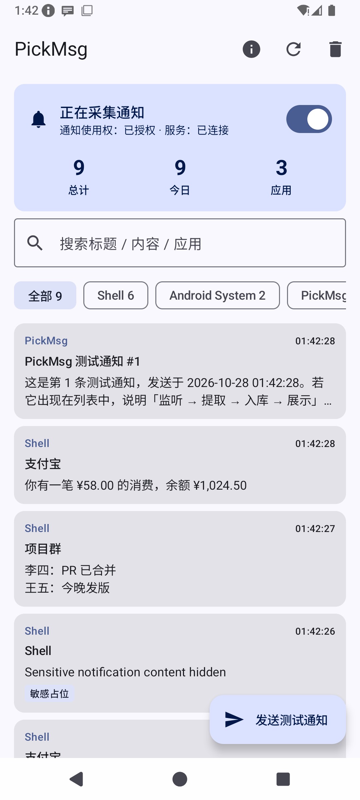
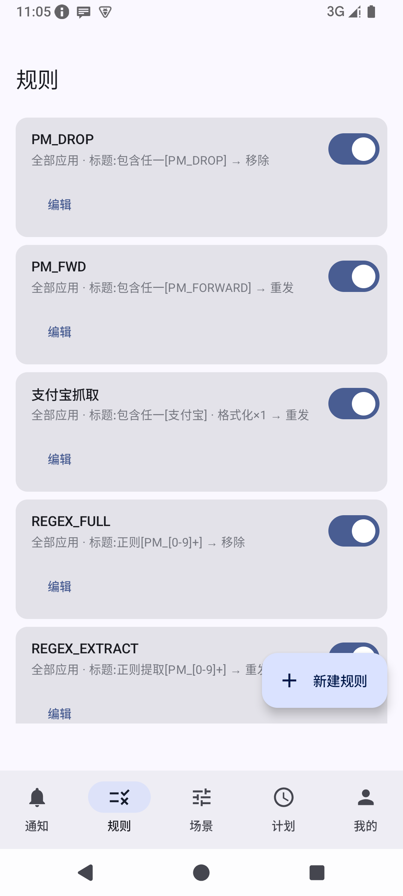
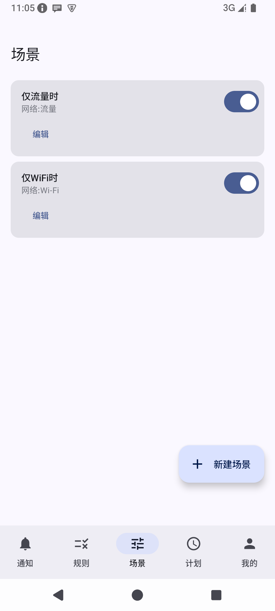
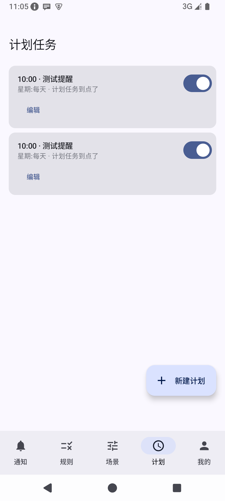
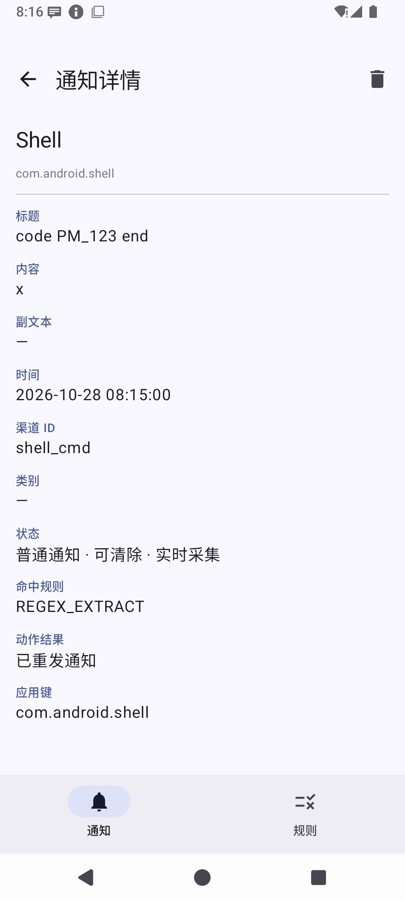

# PickMsg

**安卓系统通知采集与规则过滤工具** — 让每一条系统通知都被记录、可检索，并按你定义的规则自动移除、重发或转发。

[](https://github.com/JeckChen666/PickMsg/actions/workflows/ci.yml)

> 自用/开源项目：所有数据仅保存在本机；任何外发（Webhook/邮件/短信）只发生在你显式配置的转发动作里。

| 采集中 | 规则列表 | 场景 | 计划 | 我的 |
|---|---|---|---|---|
|  |  |  |  |  |

## 功能

### 采集

- **全量监听**：基于系统 `NotificationListenerService`（通知使用权授权），回调内零耗时、全异步协程管道
- **内容提取四层降级**：标准 extras → 展开长文本 → 多消息行去重合并 → 自定义布局离屏解析兜底
- **敏感通知保护**：系统脱敏占位符（锁屏隐私/验证码脱敏）识别后只记录不外发，避免把占位文本当真内容转发
- **去重**：`通知key + postTime` 内存单槽 + 数据库唯一索引双保险
- **通知栏快照**：连接时与手动触发时批量采集当前在栏通知；常驻通知可"一年期 snooze"无痕隐藏、随时恢复
- **暂停 ≠ 断开**：暂停采集时服务保持连接，通知栏磁贴/前台服务按钮一键切换

### 规则引擎

- **应用匹配**：全部 / 仅选中（白名单）/ 排除选中（黑名单），分身/工作资料按独立应用键区分
- **文本匹配八模式**：包含任一 / 全部包含 / 不包含任一 / 均不包含 / A且B / 正则整串匹配 / 正则提取 / 无条件（正则带编译缓存）
- **标题与内容**：且 / 或 组合；**多规则**同时命中互不影响
- **生效场景**：网络（含指定 SSID）/ 时间段（支持跨天）/ 电量区间 / 星期 / 屏幕状态，任一或全部满足
- **热更新**：规则保存/开关即时生效，无需重启服务
- **内嵌测试**：编辑规则时输入样例即时验证各侧命中结果

### 动作（11 种）

| 整理 | 提醒 | 转发 |
|---|---|---|
| 移除通知（可延迟） | 播放铃声（可强制走闹钟通道） | Webhook（企微/飞书/钉钉/Slack/Telegram 预设） |
| 替换重发（保留原通知点击跳转） | 震动（自定义波形） | 邮件（SMTP 直连，全局账号配置） |
| 复制到剪贴板 | TTS 语音播报 | 短信转发（发送结果回写） |
| 打开原通知目标 | | 手环转发（蓝牙检查 + 重复提醒） |

- 动作模板支持占位符：`{app} {title} {content} {time} {date} {week} {mobile}`
- 格式化管线（正则替换/前后缀/正则提取）先于动作执行，一处格式化处处生效
- 每个动作独立 try-catch，单个失败不影响其他；发送类动作共享重试框架（5s/10s/15s/15s/15s）

### 记录与增值

- 记录列表：按时间/应用/规则三视图分组、关键词搜索、置顶、详情全字段可复制、CSV 导出
- 定期清理：保留天数可配，置顶记录豁免，分批删除不卡顿
- 统计：今日/总计、近 7 天柱状图、规则命中 TOP
- Glance 桌面小组件（2×1）：今日通知数 + 高频应用
- 备份：本地 JSON 导出/导入（规则+场景+计划任务）、WebDAV 上传/下载、周期自动备份
- 运行日志：进程内滚动日志 + logcat，采集/命中/跳过全链路可查

## 下载安装

从 [GitHub Releases](https://github.com/JeckChen666/PickMsg/releases) 下载带签名的 release APK 安装。
首次使用需在系统设置中授予「通知使用权」（应用内有引导跳转），Android 13+ 发送测试通知会请求通知权限。

自行构建见下节；`local.properties` 指向本机 Android SDK，构建产物在 `app/build/outputs/apk/`。

## 构建

```bash
git clone https://github.com/JeckChen666/PickMsg.git
cd PickMsg
# 需要 JDK 17 与 Android SDK（API 35）；IDE 打开或直接：
./gradlew :app:assembleDebug      # 调试 APK
./gradlew :app:testDebugUnitTest  # 单元测试（45 个）
```

正式签名（自用更新安装需签名一致）：在仓库根目录创建 `keystore.properties`：

```properties
storeFile=keystore/pickmsg-release.jks
storePassword=你的密码
keyAlias=pickmsg
keyPassword=你的密码
```

并把 keystore 文件放到对应位置（两者均已在 `.gitignore` 中，勿提交）。配置后 `assembleRelease` 自动签名；
没有该配置时 release 构建回退 debug 签名，便于 CI 无密钥构建。

## 技术栈与结构

Kotlin 2.0 · Compose (Material 3) · Room + KSP · WorkManager · Glance · JavaMail-Android · minSdk 26 / target 35

```
app/src/main/java/com/pickmsg/app/
├── data/       Room v3 实体/DAO/仓库、设置存储、备份序列化、WebDAV/CSV
├── service/    监听服务、规则引擎（匹配/格式化/占位符）、动作执行器、
│               场景求值、转发通道、计划任务调度、磁贴
├── work/       自动备份 Worker
├── widget/     Glance 小组件
└── ui/         五 Tab Compose 界面（通知/规则/场景/计划/我的）
```

数据库迁移链 v1→v2→v3 保留用户数据；规则的动作配置采用 JSON 单列设计（便于整体导入导出）。

## 测试

45 个单元测试覆盖规则匹配八模式、格式化管线、模板占位符、备份序列化往返、CSV 转义与敏感占位符判定：

```bash
./gradlew :app:testDebugUnitTest
```

端到端行为（授权流程、真实通知采集、通知栏移除、计划任务触发、前后台切换）在 Android 15 模拟器完成过统一测试。
**真机注意事项**见 [docs/real-device-testing.md](docs/real-device-testing.md) — 国产 ROM 的保活与自启设置是这类工具的生死线。

## 实现笔记（踩坑实录）

1. 标题/内容的组合方式默认必须"且"——默认"或"会让单边配置的规则（另一边为无条件）匹配所有通知
2. Room 失效跟踪只认应用自身连接的写入，外部 sqlite 直写不触发热更新
3. Android 15 会自动脱敏含验证码的通知（OTP 保护），监听器只能拿到占位文本
4. 自身重发的通知会再次进入监听器，必须按包名短路，否则模板含关键词时无限重发
5. JavaMail 双 jar 的 META-INF 冲突需在 `packaging.resources.excludes` 排除
6. Glance 的 `provideGlance` 是成员方法；`provideContent` 才是顶层扩展
7. snooze 隐藏的通知不再出现在 `getActiveNotifications`，恢复需会话内缓存通知 key
8. 正则编译缓存的 `ConcurrentHashMap.getOrPut` 不能缓存 null（非法正则），否则 `putIfAbsent(key, null)` NPE——单元测试抓到的真 Bug
9. 场景网络判定应按 transport 而非 `VALIDATED` 能力，门户 Wi-Fi（部分连接）在现实里很常见
10. 前台服务通知渠道重要性必须 ≥ DEFAULT，否则通知栏不渲染操作按钮（渠道重要性创建后不可改，需用新渠道 ID）
11. 系统会不定期主动重绑监听服务（毫秒级自恢复），无需惊慌；真正要防的是阻塞 binder 回调

## 许可

[MIT](LICENSE)
