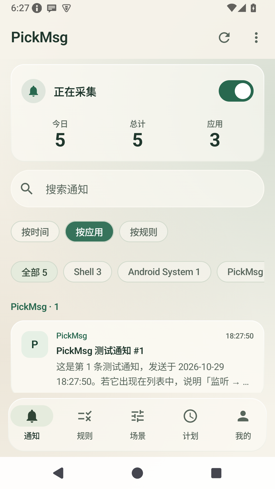
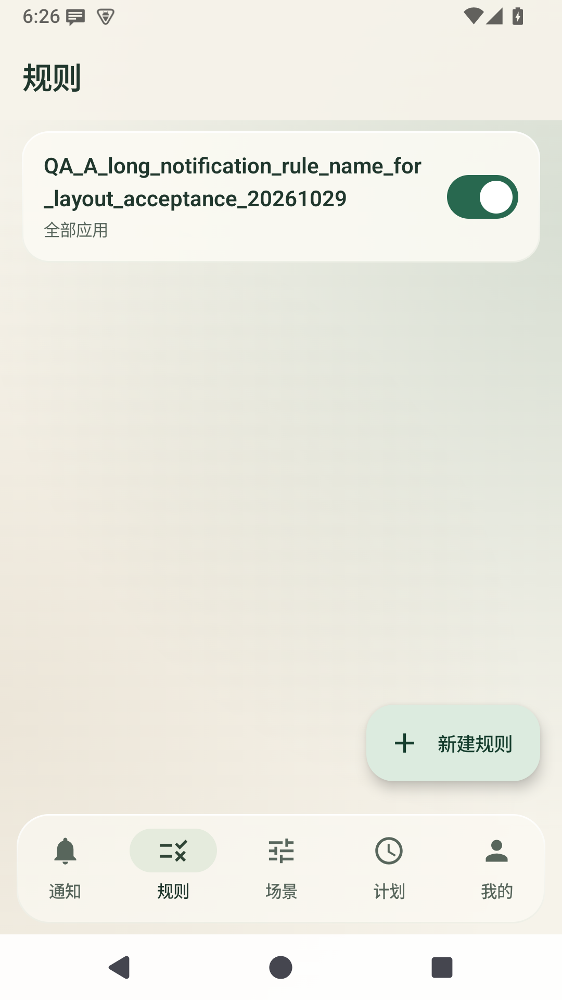
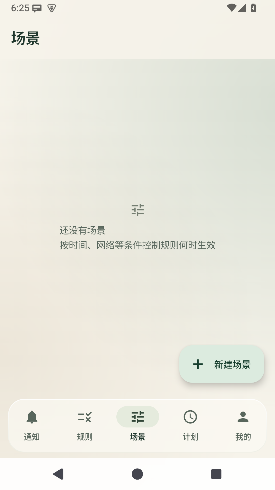
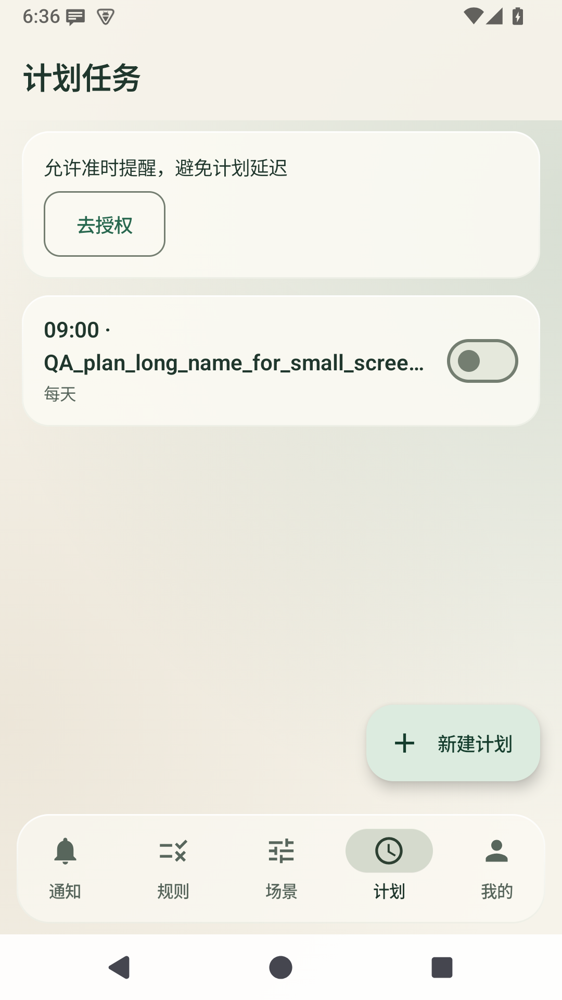
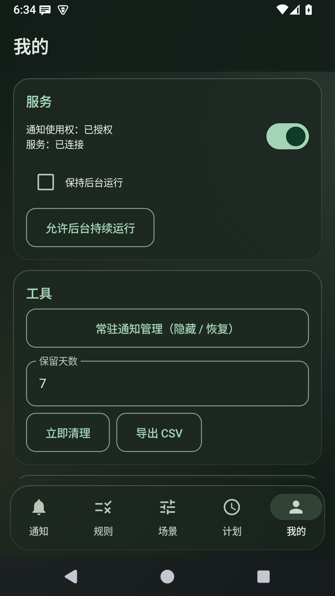
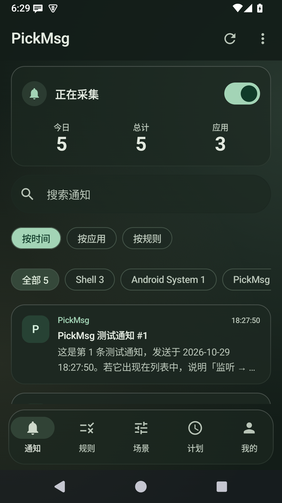
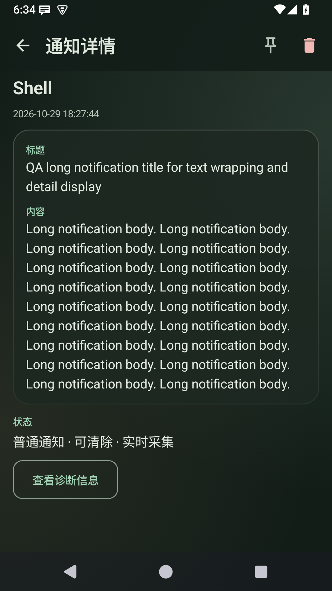
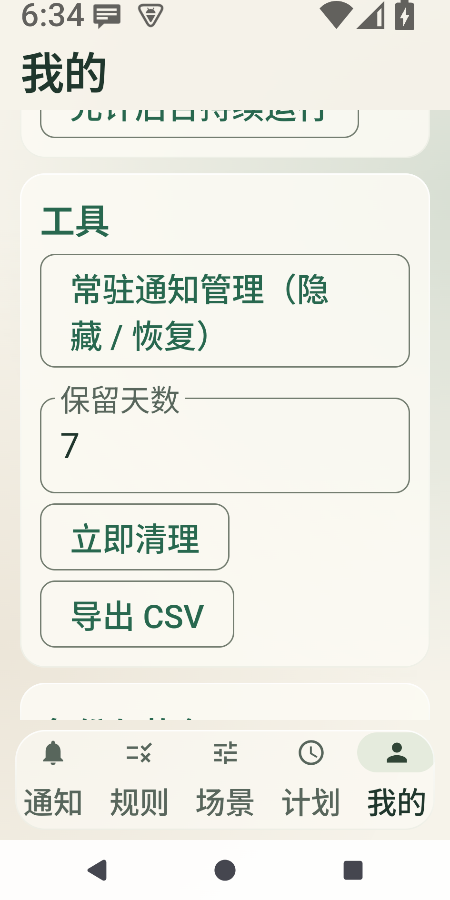

# PickMsg

安卓通知采集与规则处理工具：记录、检索系统允许读取的通知，并按规则整理、提醒或转发。

项目采用 [MIT 许可证](LICENSE) 开源。

[](https://github.com/JeckChen666/PickMsg/actions/workflows/ci.yml)

支持 Android 8.0 及以上。采集记录默认保存在本机；配置的转发动作和 WebDAV 备份会向相应目标发送数据。

[文档导航](docs/README.md) · [构建与开发](docs/development.md) · [设计规范](docs/design/DESIGN_SYSTEM.md) · [验收报告](docs/design/acceptance/ACCEPTANCE.md)

## 界面预览

暖玉绿界面的实际运行截图（2026-10-29，Android 15 模拟器）。图中为验收测试数据，场景页展示空状态；点击图片可查看原图。

| 通知 · 按应用分组 | 规则 · 长名称 | 场景 · 空状态 | 计划 | 我的 · 深色 |
|---|---|---|---|---|
|  |  |  |  |  |

<details>
<summary>查看深色模式、通知详情与大字体适配</summary>

| 深色通知列表 | 深色通知详情 | 窄屏 · 2 倍字体 |
|---|---|---|
|  |  |  |

</details>

完整检查范围与截图见 [界面精修验收报告](docs/design/acceptance/ACCEPTANCE.md)。

## 开始使用

1. 从 [Releases](https://github.com/JeckChen666/PickMsg/releases) 获取安装包，或按 [开发文档](docs/development.md) 自行构建。
2. 首次打开，在通知页进入系统设置，授予 **通知使用权**。Android 13 及以上发送测试通知时还需允许应用发送通知。
3. 返回应用，确认显示“正在采集”；在右上角更多菜单中发送测试通知，检查记录是否出现。
4. 按需创建规则；先用编辑页中的样例测试确认匹配结果，再配置动作。场景用于限制规则生效条件，计划用于定时发送本地通知。

需要持续采集时，在“我的”中检查后台运行设置，并参考 [真机测试清单](docs/real-device-testing.md) 完成设备侧验证。覆盖安装应使用相同签名，不要为解决签名冲突直接卸载旧版。

## 主要能力

| 页面 | 用途 |
| --- | --- |
| 通知 | 按时间、应用或规则查看记录，搜索、置顶、查看详情与诊断信息 |
| 规则 | 设置应用和文本匹配条件，组合整理、提醒及转发动作 |
| 场景 | 通过网络、时间、电量、星期、屏幕状态限制规则生效 |
| 计划 | 按时间和星期发送本地提醒；准时触发受系统权限影响 |
| 我的 | 管理后台运行、常驻通知、保留天数、导出、备份、邮件账号与统计 |

### 采集与记录

- 暂停采集不主动断开监听服务；可通过应用、快捷磁贴或常驻通知切换状态。
- 支持读取当前通知栏快照、去重、关键词搜索和置顶；定期清理会保留置顶记录。
- 系统脱敏的敏感占位通知只记录、不外发；无法绕过系统限制恢复原文。
- 常驻通知可以隐藏；恢复依赖当前会话缓存，不能保证应用重启后仍能立即恢复。
- 支持 CSV 导出、今日/总量统计、近 7 天趋势与规则命中统计；另提供桌面小组件。

### 规则与动作

应用范围支持全部、仅选中和排除选中。文本匹配支持包含任一、全部包含、不包含任一、均不包含、A 且 B、正则整串匹配、正则提取和无条件；标题与内容可按“且”或“或”组合。

一个场景内的条件需要全部满足，且至少应有一项条件；绑定多个场景时，规则可选择任一或全部满足。规则保存及开关变更会热更新，编辑页支持样例测试。

场景限制只考虑启用中的绑定场景；未绑定场景或绑定场景均未启用时，当前实现不限制规则执行。

| 整理 | 提醒 | 转发 |
| --- | --- | --- |
| 移除通知，可延迟 | 铃声 | Webhook：企微、飞书、钉钉、Slack、Telegram 等预设 |
| 替换重发，保留原点击目标 | 震动 | 邮件 |
| 复制到剪贴板 | 语音播报 | 短信 |
| 打开原通知目标 | | 手环提醒 |

多个规则可同时命中。内容格式化支持正则替换、前后缀及正则提取，在动作执行前处理；动作模板支持 `{app}`、`{title}`、`{content}`、`{time}`、`{date}`、`{week}`、`{mobile}`。

### 备份范围

本地 JSON 和 WebDAV 备份包含 **规则、场景、计划任务**，不包含通知历史。通知历史可单独导出 CSV；CSV 导出不等同于可导入恢复的备份。远程备份配置位于“我的 → 备份与恢复”。

## 构建与验证

需要 JDK 17、Android SDK API 35，并在 `local.properties` 中配置 SDK 路径：

```bash
./gradlew :app:assembleDebug
./gradlew :app:testDebugUnitTest
```

调试包输出到 `app/build/outputs/apk/debug/app-debug.apk`。环境准备、正式签名、CI 和实现说明见 [构建与开发](docs/development.md)。

最近一次界面验收记录为 **2026-10-29**：Debug 构建成功，50 项单元测试通过，主要界面流程及部分深色/大字体/窄屏状态已验证。完整 Lint 仍有 10 个既有错误；真机 ROM、真实外发与备份不在这次验收通过范围内。详细证据与限制以 [验收报告](docs/design/acceptance/ACCEPTANCE.md) 为准。

## 界面与维护

应用使用“暖玉绿”设计体系。新增页面先阅读 [设计规范](docs/design/DESIGN_SYSTEM.md)，复用 `ui/theme/` 中的设计常量和组件；当前效果是柔光背景与半透明表面，不是实时背景模糊。

概念稿、早期实现与旧截图保留作历史对照，不作为当前规范。各文档的定位及历史入口见 [文档导航](docs/README.md)。

## 许可

[MIT](LICENSE)
