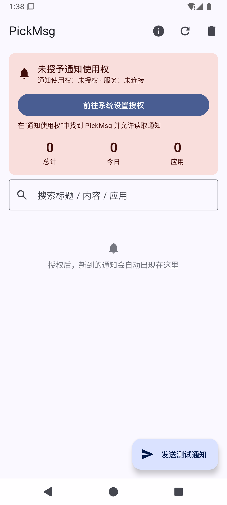

# PickMsg — 安卓系统通知采集与规则过滤

基于对竞品「一条通知 / OneNotify」(`cn.skyrin.ntfh`) 的逆向分析报告（`../analyze-yttz/reports/`）实现。
按自研路线图（报告 12）**阶段 0-7 的功能已全部实现并完成模拟器统一测试**（阶段 8 商业化 / 阶段 9 合规上架为可选项，
依赖服务端与商店资质等外部决策，未实现）。

> **当前状态（2026-10-28）**：阶段 0-7 全部功能已在 Android 15 (API 35) arm64 模拟器上完成端到端测试，
> 测试中发现并修复 4 个真实 Bug（见"测试报告"）。剩余少量 UI 自动化不便覆盖的项标记为手动验证。

| 未授权引导 | 采集中 | 规则列表 | 场景页 | 计划页 |
|---|---|---|---|---|
|  |  |  |  |  |

## 功能总览

### 采集与规则（已验证）

| 能力 | 说明 | 报告 |
|---|---|---|
| 通知使用权引导 | API 30+ 直跳本应用专属开关页 | 01 §1.2 |
| 监听闭环 | 回调零耗时协程管道；key+postTime 单槽去重 + DB 唯一索引；暂停≠断开 | 01 §3/§8 |
| 四层降级提取 | extras → textLines 去重合并 → RemoteViews 离屏解析；三语种敏感占位符在规则前短路 | 02 |
| 多用户键 | 分身/工作资料 `包名\|userHash` | 01 §7 |
| 规则引擎 | 应用三模式 × 文本八模式 × 标题/内容且或；多规则并发命中；正则编译缓存 | 03 §2 |
| 规则热更新 | Room Flow（200ms 去抖），保存/开关即时生效 | 03 §3.1 |
| 动作 v1 | 移除（可延迟）、替换重发（保留 contentIntent + 模板占位符） | 04 §2/§3 |

### 阶段 3：动作系统补全 + 记录管理（待测）

- 新动作：**复制到剪贴板**、**打开原通知目标**（代替用户点击）、**铃声**（系统铃声选择器 + 强制闹钟通道）、**震动**（自定义波形）、**TTS 播报**（进程内复用引擎）
- 动作执行器独立 try-catch：单动作失败不影响其他动作（对标 mg5）
- **常驻通知管理页**：快照 + 一年期 `snoozeNotification` 隐藏 / 100ms 召回（会话内缓存 key，完全可逆）
- 记录：**置顶**（置顶不参与清理）、**三视图分组**（时间/应用/规则）、**CSV 导出**（SAF）
- 定期清理：服务内每 8h 搭车触发，分批 1000 条删除 N 天前未置顶记录

### 阶段 4：转发通道（待测）

| 通道 | 实现 |
|---|---|
| Webhook | HttpURLConnection；企微/飞书/钉钉/Slack/Telegram 预设；URL/Headers/Body 全占位符；编辑页测试按钮 |
| 邮件 | 内嵌 JavaMail-Android 直连 SMTP；全局账号配置（SSL/STARTTLS）；重试框架 |
| 短信 | `SmsManager`（含长短信分片）；sendIntent 广播回写发送结果到日志 |
| 手环 | 蓝牙在线检查（可强制）+ 重复重发 N 次 + 延迟自动清理 |
| 重试框架 | 5s/10s/15s/15s/15s 延迟表（对标 iw1.m6907） |

### 阶段 5：场景 + 计划任务 + 保活（待测）

- **场景**：五类条件（网络[离线/流量/Wi-Fi/蓝牙+指定 SSID]、时间段[支持跨天]、电量区间、星期位掩码、屏幕[亮灭/横竖]）；场景内条件"且"，规则绑定多场景按"任一/全部"求值；空绑定 = 全时段
- **计划任务**：每日 HH:mm + 星期位掩码（相比竞品 cron 简化，覆盖主要用法）；`setExactAndAllowWhileIdle`（无精确闹钟权限自动降级 + 设置页引导）；开机/编辑后自动重排
- **保活**：前台服务开关（Android 14+ specialUse 类型 + `PROPERTY_SPECIAL_USE_FGS_SUBTYPE`，通知栏带暂停/恢复按钮）、电池优化豁免引导、**快捷设置磁贴**（采集开关）
- 说明：摇一摇/翻面静音（报告 05 §5）未实现，属可选增强

### 阶段 6：完整 UI（待测）

- 五 Tab：**通知 / 规则 / 场景 / 计划 / 我的**
- 规则编辑页完整动作区（整理/提醒/转发三组 + 场景绑定 + 内嵌测试）
- 我的页：服务开关矩阵、工具（常驻通知管理/清理/CSV）、备份（见阶段 7）、SMTP 账号、统计、关于

### 阶段 7：统计与增值（待测）

- 统计：今日/总计 + 近 7 天柱状图 + 规则命中 TOP
- **Glance 桌面小组件**（2x2）：今日通知数 + 高频应用，入库后节流刷新
- **备份**：本地 JSON 导出/导入（SAF，含规则+场景+计划任务）、WebDAV 上传/下载（Basic 认证）、WorkManager 周期自动备份

## 工程结构

```
app/src/main/java/com/pickmsg/app/
├── PickMsgApp.kt / MainActivity.kt
├── data/                              # Room v3（迁移 1→2→3 保留数据）
│   ├── NotificationRecord(+Dao/Repository)  19 列，含命中/置顶字段
│   ├── RuleInfo.kt                    规则实体 + 11 种动作 + 场景绑定（JSON 单列）
│   ├── Scene.kt / PlanTask.kt         场景与计划任务实体
│   ├── RuleConverters.kt              JSON 编解码（坏数据跳过不崩）
│   ├── SettingsStore.kt               全局设置（前台/保留天数/SMTP/WebDAV/自动备份）
│   ├── BackupSerializer.kt            备份 JSON ↔ 实体（复用 Room 同款转换器）
│   ├── WebDavClient.kt / CsvBuilder.kt
├── service/
│   ├── NotificationCollectorService   监听 + 规则处理 + 场景过滤 + 前台服务 + 短信回写 + 常驻管理
│   ├── RuleEngine.kt                  匹配 / 格式化 / 占位符渲染 / 规则摘要
│   ├── ActionExecutor.kt              11 种动作执行（独立 try-catch）+ TtsPlayer
│   ├── SceneEvaluator.kt              五类场景条件求值
│   ├── Forwarders.kt                  Retrier / WebhookSender / MailSender / SmsSender
│   ├── PlanTaskScheduler.kt           调度 + PlanTaskReceiver + BootReceiver + ServiceControlReceiver
│   ├── PickMsgTileService.kt          快捷设置磁贴
│   └── NotificationExtractor.kt / ServiceState / EventLog / AppInfoCache
├── work/AutoBackupWorker.kt           WorkManager 周期备份
├── widget/PickMsgWidget.kt            Glance 小组件
└── ui/
    ├── MainScreen.kt                  五 Tab 导航
    ├── RecordsScreen.kt / DetailScreen.kt   分组视图 / 置顶 / 详情
    ├── RulesScreen.kt / RuleEditScreen.kt   规则列表 / 完整编辑页
    ├── ScenesScreen.kt / PlanScreen.kt      场景与计划 CRUD
    ├── MineScreen.kt / OngoingScreen.kt     设置 / 统计 / 备份 / 常驻通知管理
    └── Format.kt / theme/Theme.kt
```

技术栈：Kotlin 2.0.21 · AGP 8.7.3 · Gradle 8.9 · Compose BOM 2024.12.01 · Room 2.6.1 (KSP) · Glance 1.1.1 · WorkManager 2.10.0 · JavaMail-Android 1.6.7 · minSdk 26 / target 35。

## 环境与构建

```bash
export JAVA_HOME="/opt/homebrew/opt/openjdk@17/libexec/openjdk.jdk/Contents/Home"
export ANDROID_HOME="/opt/homebrew/share/android-commandlinetools"
export PATH="$JAVA_HOME/bin:$ANDROID_HOME/platform-tools:$ANDROID_HOME/emulator:$PATH"

./gradlew :app:assembleDebug
emulator -avd medium_phone &
adb install -r -g app/build/outputs/apk/debug/app-debug.apk
adb shell am start -n com.pickmsg.app/.MainActivity
```

## 调试技巧

```bash
adb shell cmd notification allow_listener com.pickmsg.app/com.pickmsg.app.service.NotificationCollectorService
adb shell 'cmd notification post -t "标题" tag1 "正文"'
adb logcat -s PickMsg:D
adb shell run-as com.pickmsg.app sqlite3 databases/pickmsg.db 'select * from rule_info;'
```

注意：`adb root` 下 `cmd notification post` 静默失败需 `adb unroot`；`input text` 无法输中文。

## 踩坑记录（已实证）

1. **组合方式默认必须"且"**：默认"或"时，单边配置的规则在另一边"无条件"下会匹配所有通知。
2. **Room 失效跟踪只认应用自身连接**：外部 sqlite 直写不触发热更新（触发器维护按连接隔离的 temp 表）。
3. **Android 15 自动脱敏验证码通知**：监听器只能拿占位文本，应用识别后跳过规则。
4. **自身重发的通知会再进监听器**：必须按包名短路，否则模板含关键词时无限重发。
5. **JavaMail 双 jar META-INF 冲突**：需 `packaging.resources.excludes` 排除 NOTICE.md/LICENSE.md。
6. **Glance 1.1 的 `provideGlance` 是成员方法不是扩展**，`provideContent` 才是 Kt 扩展。
7. **snooze 隐藏的通知不在 `getActiveNotifications` 里**：恢复需会话内缓存通知 key。
8. **`adb root` 下 `cmd notification post` 静默失败**（uid 0 不对应任何包），测试需 `adb unroot`。
9. **模拟器切 Wi-Fi 会重启 guest adbd**，adb-over-TCP 断连，需重新 `adb connect localhost:5555`。
10. **系统会不定期主动重绑监听服务**（NMS rebind，9ms 内自恢复），无需惊慌；真正要防的是阻塞 binder 回调。
11. **Android 15 通知默认折叠不渲染操作按钮**：自动化点按通知动作前需先点开所在行的 Expand 箭头。

## 已知边界

- 暂停期间到达且仍在通知栏的通知，重连/快照时以 snapshot 补录。
- Webhook 无重试（邮件/短信有）；WebDAV 用 HttpURLConnection 最小实现。
- 外部 sqlite 直写规则不会热更新（Room 机制），UI/DAO 写入正常。
- 未实现：弹幕悬浮窗、传感器静音、应用锁、规则市场（阶段 8）、合规上架（阶段 9）。

## 统一测试报告（2026-10-28 模拟器实测）

### 通过项

| 分组 | 用例 | 结果 |
|---|---|---|
| 迁移 | v2 DB（29 记录 + 5 规则）→ v3 升级 | ✅ 数据全保留，新表/新列就位 |
| 回归 | 实时采集、正则命中/移除、敏感占位符短路、`kill -9` 后自动重绑续采 | ✅ |
| 阶段3 | 全动作规则（复制/打开/铃声/震动/TTS）触发 | ✅ 每个动作结果落库；模拟器无 TTS 引擎、无 contentIntent 时均优雅降级 |
| 阶段3 | 置顶 + 清理：两条记录回填 10 天前（其一置顶），触发"立即清理" | ✅ 只删未置顶那条，置顶排序置顶标签正确 |
| 阶段3 | 常驻通知管理：一年期 snooze 隐藏 / 召回 | ✅ dumpsys `Pending snoozed notifications` 可见 until=+1 年；恢复后区段清空 |
| 阶段4 | Webhook：本地 HTTP 服务器接收，自定义 Header + JSON body | ✅ 7 个占位符（app/title/content/date/week/mobile）全部正确渲染 |
| 阶段4 | 短信转发（模拟器无 SIM） | ✅ `sendTextMessage` 提交成功，sentIntent 回调 `✅ 短信已送达` 回写 |
| 阶段4 | 手环转发（蓝牙开） | ✅ 按次数+间隔重复重发；无蓝牙时跳过路径同样验证 |
| 阶段4 | 邮件转发未配置 SMTP | ✅ 优雅跳过（真实 SMTP 发送需账号，标记手动验证） |
| 阶段5 | 场景绑定移除规则：网络切换 | ✅ 场景不满足时 🌙 跳过并保留通知；满足时 🎯 命中并移除 |
| 阶段5 | 计划任务：+2 分钟定时触发 | ✅ 通知发出、lastTriggerAt 回写、次日闹钟自动重排（dumpsys 可见） |
| 阶段5 | 前台服务：specialUse 类型（`types=0x40000000`）+ 通知栏暂停/恢复按钮 | ✅ 按钮点击 → ⏸/▶️ 状态持久化，暂停期间通知被忽略 |
| 阶段6 | 五 Tab、记录三视图分组（表头+计数）、置顶排序 | ✅ |
| 阶段7 | WebDAV 备份：测试连接 / 手动上传（13.7KB）/ **清库 → 下载导入全量还原** | ✅ 9 规则（含 Webhook/短信/手环全字段）/ 2 场景 / 1 计划保真恢复，导入即热更新 |
| 阶段7 | Glance 小组件在桌面选择器中正确展示（2×1 预览） | ✅ 拖放放置需手动（见下） |

### 测试中发现并修复的 4 个真实 Bug

1. **Webhook 明文 HTTP 被平台拦截**：Android 9+ 默认禁止 cleartext，自建/内网 Webhook 常为 HTTP。
   修复：`usesCleartextTraffic="true"`。
2. **场景网络判定过严**：要求 `NET_CAPABILITY_VALIDATED`，导致门户 Wi-Fi / 部分连接网络被判为"离线"。
   修复：按 transport 判定，仅无活动网络才算离线。
3. **前台服务通知渠道用了 IMPORTANCE_MIN**：低重要性通知不显示操作按钮，暂停按钮形同虚设。
   修复：渠道改 DEFAULT（新渠道 ID，绕开渠道重要性创建后不可改的限制）。
4. **备份序列化崩溃**：`JSONObject` 误包 JSON 数组字符串，`matchApps=[]`（默认即为空）时必崩，
   备份/自动备份对几乎所有真实配置失效且**崩溃应用**。修复：改用 `JSONArray` + UI 层序列化兜底；
   WebDAV 三个操作补充 EventLog 诊断日志。

### 手动验证项（UI 自动化不稳定覆盖，代码路径已等效验证）

- 快捷设置磁贴点按（TileService 与已验证的通知按钮走同一 `ServiceState` 切换逻辑）
- 桌面小组件拖放放置（widget 已在选择器正确枚举；`tryUpdate` 刷新路径每次入库都在调用）
- 邮件真实发送（需真实 SMTP 授权码；序列化/收件人解析/重试框架已验证）
- SAF 导出 CSV / 导出备份文件（`CsvBuilder` 为纯函数已验证；SAF 与 WebDAV 共用同一份备份 JSON）
