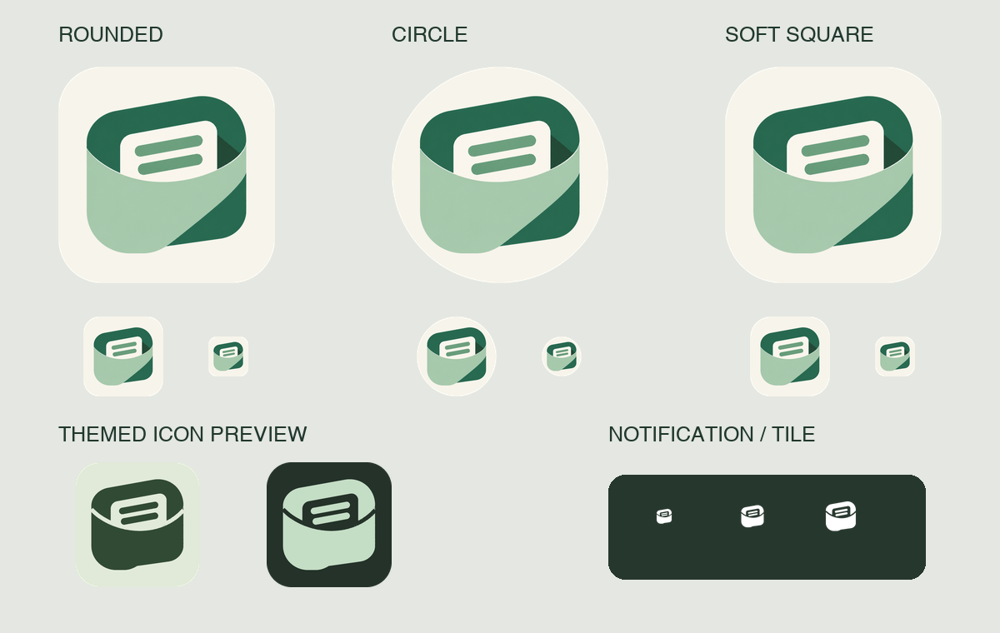

# PickMsg 品牌图标

定稿方向：A4-3 口袋造型 + 第四轮 01 米白底板。此目录是当前图标资源的维护入口，候选图仍保留在 `docs/design/logo-concepts/`，不作为运行时资源使用。



## 资源分工

| 文件 | 用途 |
| --- | --- |
| `source/approved-ivory.png` | 用户选定的原始位图稿，包含展示背景，仅作为生成输入 |
| `pickmsg-symbol.png` | 提取后的透明口袋主体，无灰色展示背景、无额外底板 |
| `pickmsg-icon.png` | 文档用米白圆角图标 |
| `pickmsg-store-512.png` | 512 × 512、不透明方形导出；应用商店仍需自行完成发布配置 |
| `asset-metadata.json` | 源文件摘要、提取区域、自适应尺寸及安全区测量 |
| `icon-preview.png` | 圆角、圆形、柔和方形、单色及通知尺寸的本地预览，不代表所有厂商桌面 |

## Android 接入

- `drawable-nodpi/ic_launcher_foreground.png`：透明前景，1080 × 1080 对应 108 dp 自适应层。
- `values/colors.xml`：米白背景 `#F7F4EB`，与绿色主体分层，不使用绿色套底。
- `mipmap-anydpi-v26/`：Android 8 及以上自适应图标，不预先把外层圆角烘焙进背景。
- `mipmap-anydpi-v33/`：补充 Android 13 及以上单色主题图标。是否启用、如何着色取决于桌面设置与支持情况，不随应用深色模式直接替换。
- `mipmap-mdpi` 到 `mipmap-xxxhdpi`：48 / 72 / 96 / 144 / 192 px 的普通及圆形回退资源。项目最低版本仍为 API 26，不新增更低系统支持承诺。
- `drawable-nodpi/ic_pickmsg_notification.png`：透明底白色简化标志，供通知栏和快捷设置磁贴使用；不直接缩放完整彩色底板。

前景像素的最远半径为约 31.5 dp，位于 66 dp 直径的圆形安全区内。米白留白是设计的一部分，不要为追求“更大”把主体拉满自适应画布。

## 重新生成

```bash
python3 -m pip install Pillow
python3 scripts/generate_brand_assets.py
```

脚本只做离线提取、单色简化、缩放和裁切预览，不调用生图 API；正常 Android 构建不需要 Python。生成资源已直接存放于 `app/src/main/res/`。

这是从已选位图制作的 PNG 资源，不是矢量稿。更换源图后，必须重新核对主体提取、透明边缘、单色可读性和安全区，不能仅通过构建结果判断视觉正确。
