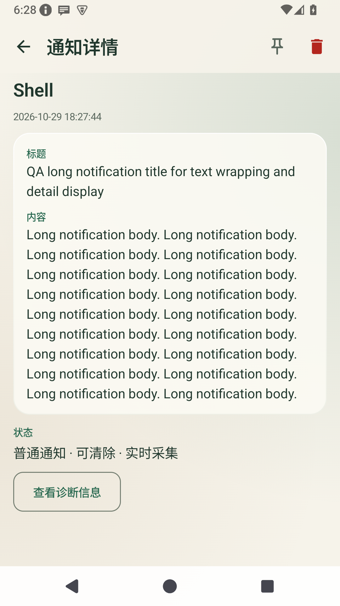
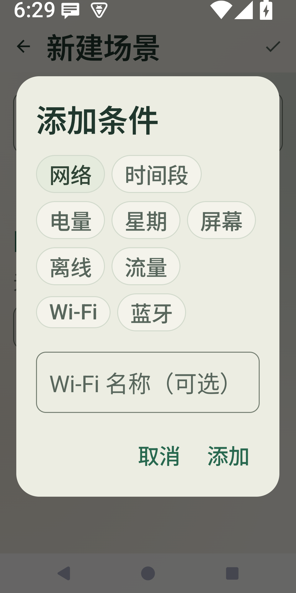
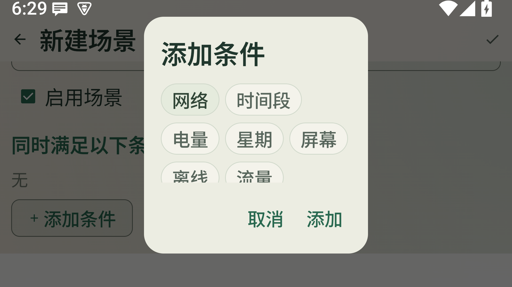

# 暖玉绿界面精修与验收报告

[文档导航](../../README.md) · [设计规范](../DESIGN_SYSTEM.md) · [真机测试清单](../../real-device-testing.md)

日期：2026-10-29。结论：**本轮列出的应用内界面与交互检查通过；不是全平台、全业务认证。**

## 1. 本轮修正

| 问题 | 处理 |
| --- | --- |
| 规则、场景、计划卡片有重复的编辑行，占据较多空间 | 共用管理卡片，点击整卡编辑，开关单独操作；限制标题/摘要行数，保留完整编辑入口 |
| 编辑页系统返回与顶部返回不一致 | 接入页内返回；二级页面隐藏主导航，返回后恢复 |
| 键盘和主导航挤占输入区域 | 键盘 Insets 统一处理，主页面输入时暂时隐藏导航 |
| 场景条件、格式化弹窗在大字体/短屏下可能溢出 | 弹窗正文独立滚动，确认和取消留在操作区域 |
| 删除按钮直接执行删除 | 通知、规则、场景、计划统一二次确认，取消不执行删除 |
| 详情页正文与技术字段混在一起 | 正文单独成卡，诊断信息默认折叠，字段和可选择复制能力保留 |
| 置顶后详情按钮状态未跟随记录变化 | 从实时记录中解析当前详情，避免一直显示旧快照 |
| 相同应用的通知交错出现时生成重复 LazyColumn 键 | 分组一次生成一个唯一标题，保留组内已有顺序；增加 5 项单元测试 |
| 设置页说明偏技术化、配置表单过长 | 简化后台运行文案，备份和邮件账号按需展开 |
| 2 倍字体下保留天数字段过窄 | 改为整行输入，操作按钮自动换行，不压缩文本 |
| 计划授权提示挤占短屏内容 | 提示与内容放在同一滚动列表 |
| 半透明导航透出平台投影底板 | 取消该投影，用薄边框与留白分层 |
| 透明页框推导不到正确前景色 | 显式使用 onBackground，修正深色模式下的局部黑字 |
| 长页面标题、空状态小屏表现 | 标题单行省略，空状态允许滚动，不强行固定内容高度 |

没有修改通知采集、规则匹配、转发通道和数据库结构。通知分组展示是本轮唯一调整的数据组织逻辑，已有回归测试保护。

## 2. 环境和数据隔离

- 独立 AVD：`pickmsg_ui_20261029`，Android 15 / API 35；未清理或修改原有 `medium_phone` 的数据。
- 默认屏幕 1080 × 1920，density 420；窄屏 945 × 1890（约 360 dp 宽）；横向尺寸 1920 × 1080。
- 字体：默认与 2.0 倍；深浅主题均有截图检查。
- 仅创建本地 QA 测试数据：无动作规则、临时场景、关闭启用开关的计划、Shell/应用自身测试通知；没有执行外发动作。
- 第一轮 ADB 37 在宿主机崩溃；使用临时 ADB 35 工具重跑。另修正了验收脚本在横向尺寸下从导航区域起滑的问题。历史中断证据保存在 `diagnostics/`，不计作通过结果。

## 3. 逐项结果

| 页面/状态 | 实际检查 | 结果 / 证据 |
| --- | --- | --- |
| 通知首次进入 | 未授权提示、授权入口、零数据 | 通过，`01-unauthorized.png` |
| 通知列表 | 时间/应用/规则三视图切换；无匹配搜索、清除搜索 | 通过，`07`、`08`、`09` |
| 采集状态 | 暂停与恢复后状态文案变化 | 通过，`results-followup.json` |
| 通知详情 | 长标题/长正文、默认隐藏诊断、展开诊断、置顶/取消置顶、删除取消 | 通过，`10`、`11`、补充断言 |
| 规则 | 空列表、空名称错误、长名称保存与整卡编辑、开关不触发编辑、删除取消 | 通过，`02-empty-规则`、`05` |
| 规则格式化 | 打开默认格式化弹窗、取消返回编辑 | 通过，`04-format-dialog.png` |
| 场景 | 空列表、空名称错误、条件弹窗、保存 QA 场景、确认删除后回到空列表 | 通过，`02-empty-场景`、`06` |
| 计划 | 空列表、空名称错误、系统返回；长名称禁用计划展示、编辑、删除取消 | 通过，`02-empty-计划`、`20` |
| 我的 | 默认折叠、展开备份、字段与操作按钮、常驻通知工具进入/系统返回 | 通过，`12`、`13`、`21` |
| 键盘 | 规则名输入时主导航不显示，编辑页可操作 | 通过，`03-rule-keyboard.png` |
| 窄屏 + 2 倍字体 | 通知页、设置工具区、场景条件弹窗及取消 | 通过，`14`、`15`、`16`；工具字段修正后复核 `24` |
| 横向尺寸 + 2 倍字体 | 场景编辑页滚动到添加条件、打开弹窗、取消返回 | 通过，`17-landscape-dialog.png` |
| 深色 | 规则列表、通知列表、通知详情正文/状态、设置 | 通过，`18`、`19`、`22`、`23` |

截图中边缘的半条列表项表示可继续滚动，不作为组件截断。大字体会增加页面高度，需要滚动；没有通过缩小字体来强行塞进一屏。

### 重点截图

配图取自本轮最终检查及修正后的补充检查。早期失败截图仅保存在 `diagnostics/`，不代表当前效果。

| 长正文与信息层级 | 深色正文与状态文字 |
| --- | --- |
|  |  |

| 窄屏 · 2 倍字体弹窗 | 窄屏 · 修正后的工具区 |
| --- | --- |
|  |  |

横向尺寸与 2 倍字体下，弹窗正文可以滚动，操作区保持可见：



## 4. 自动验证

- `:app:assembleDebug`：成功。
- `:app:testDebugUnitTest`：**50 项，0 失败**（原有 45 项 + 分组回归 5 项）。
- 新测试：`app/src/test/java/com/pickmsg/app/ui/RecordRowsTest.kt`，覆盖交错应用、同名不同包名、未命中规则、多规则标签、空列表、置顶/时间顺序保留。
- 主脚本：`scripts/ui_acceptance.py`；默认流程只应在干净的专用 `pickmsg_ui_*` 模拟器上运行，会创建 QA 记录，不会清除已有数据。
- 主流程最终完成：`results-all.json`。补充检查：`results-followup.json`。截图及 UI 层级 XML 留在同目录。
- 脚本控件断言和截图检查是两部分：已人工检查截图总览，并放大复核详情深色、大字体工具区和计划卡片。
- `git diff --check`：通过。

示例（应用 APK 需先安装，端口与设备号按实际环境填写）：

```sh
python3 scripts/ui_acceptance.py \
  --adb /path/to/adb \
  --server-port 5038 \
  --serial emulator-5556 \
  --output docs/design/acceptance
```

脚本会拒绝物理设备和非 `pickmsg_ui_*` AVD；不要为了重跑而清空日常使用的模拟器或真机。

## 5. 仍未通过或不在本轮结论内

1. **完整 Lint 仍未通过**：10 个原有错误、40 个警告，错误集中在 `PickMsgWidget.kt`、`PickMsgTileService.kt` 和 `AndroidManifest.xml`。本轮界面文件未新增 Lint 错误；不把构建成功等同于全项目静态检查通过。
2. **真机与旧系统待验**：API 26、厂商 ROM、TalkBack 全流程、帧率/耗电和长期运行未验证。
3. **外部业务未实测**：邮件/Webhook/短信/WebDAV 连接、真实闹钟触发、系统权限页中的人工授权、隐藏/恢复真实常驻通知，均未为了 UI 验收执行。
4. **组合状态有限**：不是每一种条件/格式化类型与每个字号、键盘、横屏的笛卡尔积。横向尺寸的弹窗检查不包含软键盘同时展开；截图也不代替完整色彩对比度认证。
5. **未保存草稿仍是页面内状态**：本轮没有新增草稿自动保存或进程恢复能力，离开编辑页或系统重建可能丢失未保存内容。系统返回按“放弃编辑”处理，与顶部返回一致。
6. 桌面 Glance 小组件、系统通知样式不属于这轮 Compose 界面精修。

## 6. 后续建议

先在日常使用手机上用同签名安装包复核键盘、滚动和系统授权；不要卸载现有应用来绕过签名问题。随后单独处理已有 Lint 阻断项；草稿恢复应作为独立交互需求设计，而不是隐式混进样式调整。
