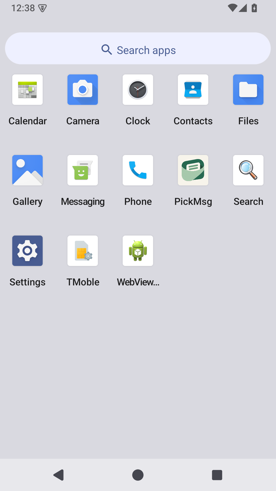
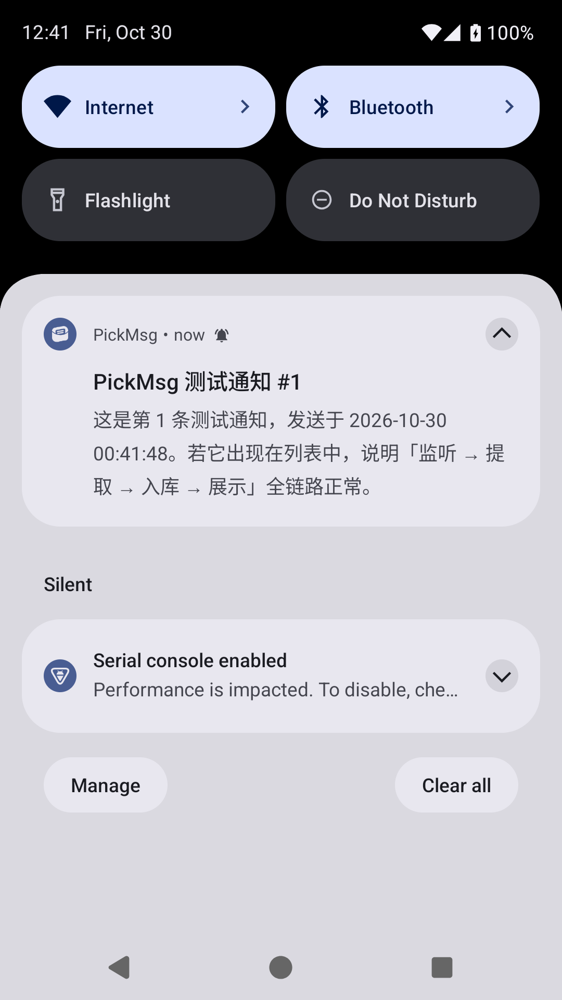
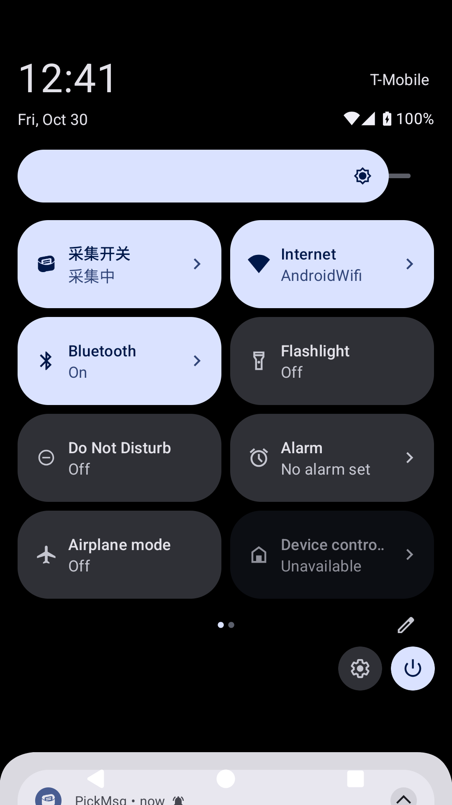

# v0.5.1 图标接入验收

日期：2026-10-30。记录基于 v0.5.0 的图标小版本本地验收；版本发布信息见 [v0.5.1 发布说明](../../releases/v0.5.1.md)。

## 实际显示

| Android 15 应用列表 | 通知栏单色标志 | 快捷设置磁贴 |
| --- | --- | --- |
|  |  |  |

图片来自专用模拟器 `pickmsg_ui_20261029`。应用由桌面图标正常打开，并发送了本地测试通知；没有使用用户的日常设备或发送外部消息。

## 资源检查

- 采用已选的 01 米白底板方案，透明口袋前景与背景分离；正式资源入口为 [品牌图标](../../../assets/branding/README.md)。
- Android 8 自适应图标和 Android 13 单色图标分别使用 v26 / v33 资源限定，Manifest 同时声明普通及圆形图标。
- 前景在 108 dp 图层中的最大有效半径为约 31.5 dp，未超过 33 dp 的安全半径；圆形与圆角裁切预览中主体完整。
- 10 个多密度回退 PNG 的尺寸与透明通道有效。
- 通知资源为透明底白色像素，不使用完整彩色底板。
- APK 元数据为 `versionName = 0.5.1`、`versionCode = 6`，正式包签名验证通过。
- 检查结果和 APK 摘要见 [checks.json](checks.json)；原始图源摘要及裁切数据见 [资源元数据](../../../assets/branding/asset-metadata.json)。

## 构建与测试

- Debug 和正式签名 Release 构建成功。
- **53 项现有单元测试通过，0 失败**，包含 v0.5.0 的常驻通知折叠相关测试。
- 本轮没有调整通知采集、更新折叠、规则匹配、转发或数据库逻辑；相关代码改动仅替换图标资源引用。
- 没有新增业务单元测试；图标尺寸、安全区、透明度和资源引用使用生成脚本断言及资源检查验证。
- Release 构建中的 Lint Vital 完成；本轮未将其视为全量 Lint 或全平台验收。

## 限制

圆形、圆角和单色配色图是离线预览，不等同于每种 Launcher 的真实效果。Android 15 的应用列表、通知栏和磁贴已实际检查；API 26 真机、厂商桌面、系统单色主题开关与动态壁纸配色仍需目标设备确认。

当前使用从定稿提取的 PNG，不宣称已完成矢量化。主图、单色轮廓和状态栏尺寸有所区别，是为各自显示场景做的适配。
