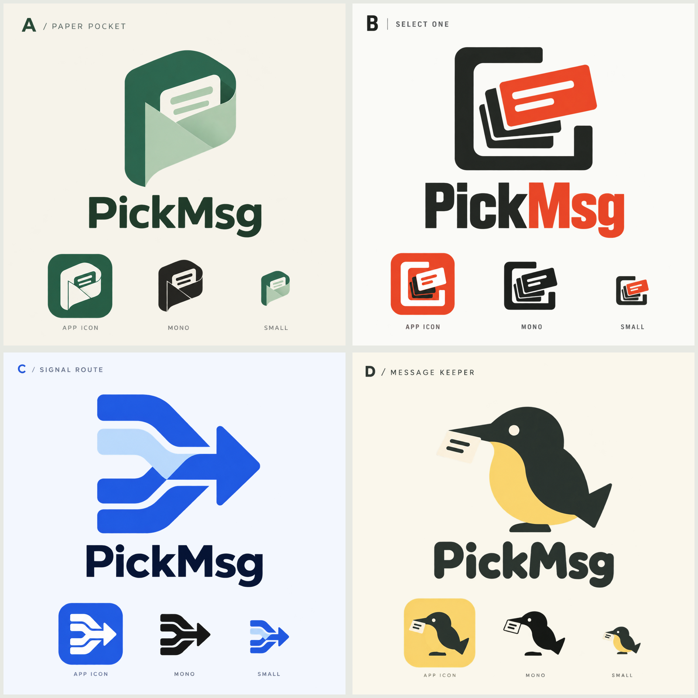

# PickMsg Logo 候选 · 第一轮

日期：2026-10-29。阶段：开放方向探索，尚未选择或应用到产品。

后续进展：用户选择 A 方向继续发展，见 [第二轮候选](../round-02/README.md)。本页保留第一轮探索记录。

## 设计依据

PickMsg 的核心是采集通知、挑选重要消息、按规则处理；不是聊天软件。现有界面为暖玉绿，但这一轮不限制品牌色，优先比较符号与气质。

| 候选 | 表达 | 气质 | 后续需要关注 |
| --- | --- | --- | --- |
| A · 纸袋收纳 | 折叠口袋收住消息，轮廓隐含 P | 温润、安静、秩序感 | 简化折面，避免被理解为邮件应用 |
| B · 焦点拾取 | 从消息堆中挑出一张 | 醒目、直接、工具感 | 减少内部线条，保持小图标清晰 |
| C · 信号汇流 | 多路消息汇聚为一条处理路径 | 理性、技术、自动化 | 避免过于接近通用转发箭头 |
| D · 拾信小鸟 | 小鸟衔住一条消息 | 亲切、轻松、角色感 | 调整可爱程度，校正图标与主标轮廓 |

## 文件

- `*-board.png`：补上浅色底的展示图，便于对比和阅读。
- `a-pocket.png`、`b-select.png`、`c-flow.png`、`d-bird.png`：原始生成结果。
- `*.prompt.txt`：本轮使用的英文提示词。
- `comparison.png`：本地拼合的四方案对比图。

各方案包含主标、桌面图标、单色和缩小示意；它们是 AI 生成的位图概念稿，不是完成矢量化或尺寸验收的生产资产。下一轮先根据选择收敛图形，再统一几何、字标、颜色和 Android 图标适配。未进行商标近似性检索。

本轮不替换应用图标，不改动已发布版本，不自动提交或推送。
