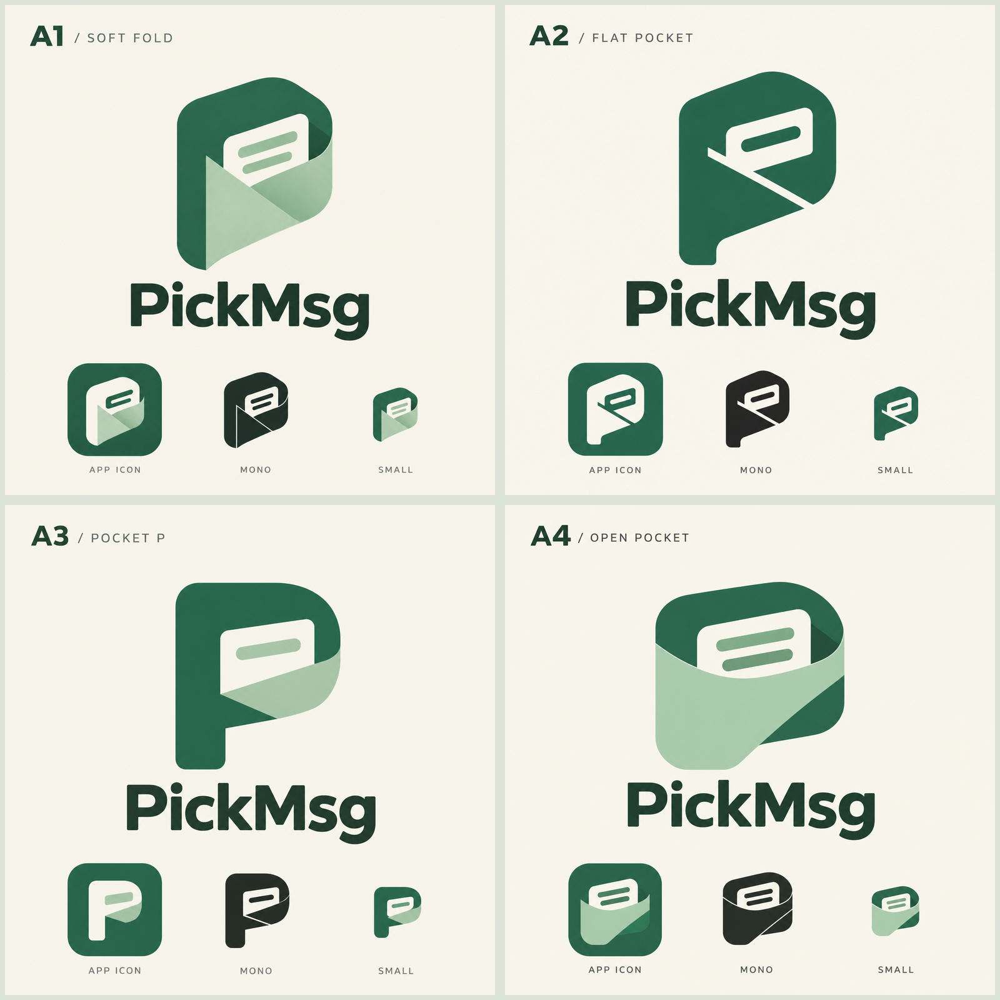

# PickMsg Logo 候选 · A 方向第二轮

日期：2026-10-29。用户选择第一轮 A，继续探索折叠口袋、消息卡片与 P 的组合。

后续进展：用户选择本轮 A4，见 [第三轮精修](../round-03/README.md)。本页保留第二轮候选记录。

本轮统一玉绿色系与字标气质，重点比较结构；以第一轮 `a-pocket-board.png` 为参考生成，不是重新选择四种无关风格。

| 候选 | 变化 | 取舍 |
| --- | --- | --- |
| A1 · 柔和折纸 | 保留原案的折面、双行消息和收纳感，调整比例 | 最接近原案，材质感强，但细节较多 |
| A2 · 极简口袋 | 用大色块和留白切口代替层叠折面，消息简化为一行 | 更利落，便于继续做单色图标；口袋感稍弱 |
| A3 · 字母 P | 强化直立 P 的外轮廓，将消息收进字母内部 | 字母辨识度更高，造型更稳重；需要避免过于通用 |
| A4 · 开口收纳 | 拓宽口袋、突出露出的消息，弱化字母结构 | 更亲和、收纳含义更直观，P 的辨识度较低 |

`*.prompt.txt` 为生成提示词；无后缀图片为原始结果；`*-board.png` 为统一展示底色后的图片。底部的桌面图标、单色和缩小效果仅为概念示意，并非已经完成尺寸测试的生产资产。

选定结构后再统一主标与图标几何，处理矢量化、单色轮廓、Android 自适应图标安全区及小尺寸辨识度。本轮未修改应用图标，未提交或发布。
