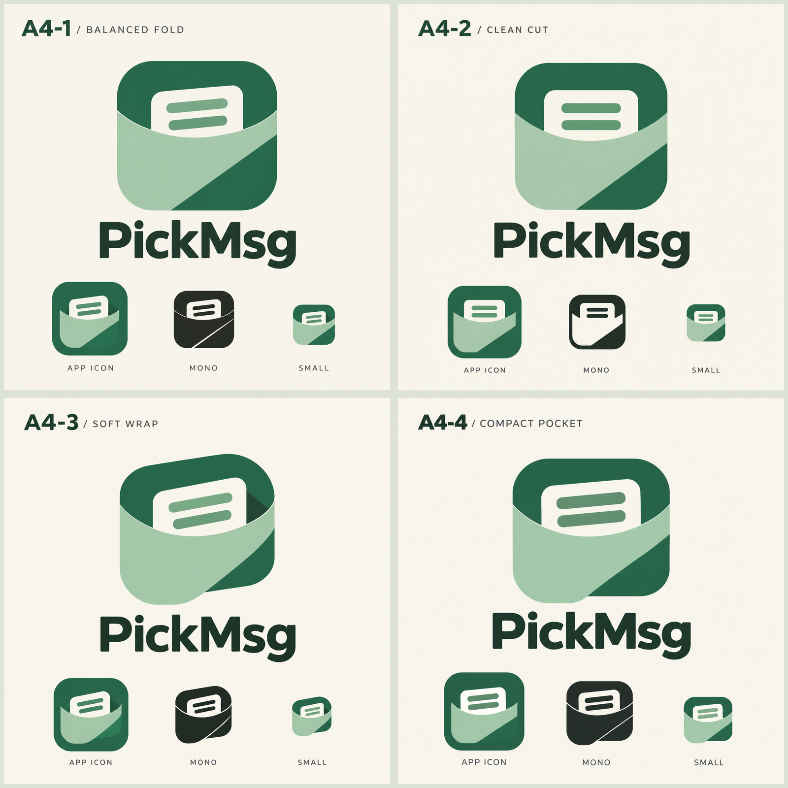

# PickMsg Logo 候选 · A4 方向第三轮

日期：2026-10-29。用户选择第二轮 A4，继续精修宽圆口袋与露出的消息卡片，不再强求字母 P 的辨识度。

后续进展：用户选定 A4-3，并要求解决桌面图标绿色底板与主体混合的问题，见 [图标层级优化](../round-04/README.md)。

本轮以 `round-02/a4-open-pocket-board.png` 为参考，保持玉绿色系，比较口沿、折面和卡片比例。四个方案属于同一设计家族，差异有意收敛。

| 候选 | 本轮呈现的主要差异 | 取舍 |
| --- | --- | --- |
| A4-1 · 均衡折面 | 更规整的外轮廓，轻微倾斜的消息卡片 | 稳妥地延续原案 |
| A4-2 · 简洁切面 | 正面、居中的卡片，更简化的折面结构 | 更利落；单色示意更容易继续简化 |
| A4-3 · 柔和包裹 | 更明显的弧形包裹与倾斜，延续原案的柔和感 | 形象更有温度，仍需控制折面细节 |
| A4-4 · 紧凑收纳 | 放大卡片和消息条，增强图形主体的视觉分量 | 更醒目，但字标与细节仍需统一 |

原始生成结果、展示底色版本与英文提示词均在本目录。图中桌面图标、单色和缩小版本仍是概念示意，未进行正式矢量化或实际像素尺寸验收。

下一轮应优先确定一个外轮廓，再统一字标、线条与折面的处理，制作单色和 Android 自适应图标。此次未替换应用图标，未提交或发布。
