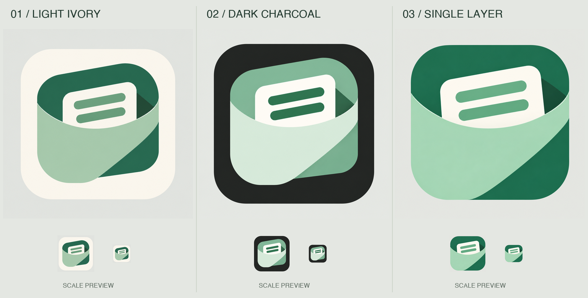

# A4-3 桌面图标 · 主体与底板分离

用户已选择 A4-3，但不喜欢桌面图标中绿色主体与绿色外底板混在一起的表现。本轮只处理图标层级，主 Logo 与字标方向不变。

| 方案 | 处理 | 取舍 |
| --- | --- | --- |
| 01 · 米白底板 | 原玉绿口袋放在米白底板上，四周保留清晰留白 | 最接近原 Logo，轮廓独立完整 |
| 02 · 深色对比 | 炭灰底板配更浅的玉绿主体 | 内外对比更强，整体气质更重 |
| 03 · 单层一体 | 口袋本身成为图标外形，不再另套绿色底板 | 消除重复轮廓，主体更醒目；需进一步适配 Android 裁切 |

生成参考 `selected-symbol-reference.png` 从第三轮 A4-3 的主标中裁取，没有把旧的绿色套底图标作为参考。每种方案只生成一个图标，下方缩小示意由同一原图在本地缩放，避免模型分别重画导致几何不一致。

`01-ivory.png`、`02-charcoal.png`、`03-integrated.png` 为原始生成结果；`*.prompt.txt` 为提示词。当前是位图方案，未完成矢量化、自适应遮罩、安全区和不同桌面环境验收。

尚未替换应用图标，未提交或发布。

后续选择：用户确定 01 米白底板，正式资源维护入口为 [品牌图标](../../../../assets/branding/README.md)。本页保留候选阶段记录。
